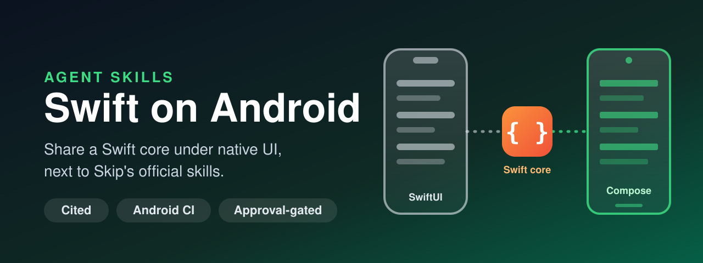

<p align="center">
  
</p>

# Swift Android Agent Skills

[](https://github.com/alexey1312/Swift-Android-Agent-Skill/actions/workflows/validate.yml)
[](https://github.com/alexey1312/Swift-Android-Agent-Skill/actions/workflows/android.yml)
[](LICENSE)
[](https://github.com/alexey1312/Swift-Android-Agent-Skill/releases)

**Agent Skills for Swift code that also has to run on Android.**
They help an AI coding agent decide how Swift reaches an Android app,
keep a shared Swift core portable under a native Kotlin and Compose UI,
and build with the Swift SDK for Android and swift-java when there is no Skip at all.
The skills work in any AI coding tool that supports the
[Agent Skills open format](https://agentskills.io/home).

Since Swift 6.3, Android is an official Swift platform,
and [Skip](https://skip.dev) builds whole iOS and Android apps from one Swift codebase.
In August 2026 Polymarket described an Android app built on
[170,000 lines of Swift shared with iOS](https://forums.swift.org/t/our-android-app-is-written-in-swift/88778),
under a UI written natively in Compose.
These skills turn that kind of experience, the documentation behind it,
and what this repository's own Android CI measures,
into a workflow an agent can follow:
report what the machine can verify, scan the code, propose a plan where every item cites a source,
change code only after approval.

**Website:** <https://blog.kakoulin.com/apps/swift-android-agent-skills>

## Works alongside Skip's official skills

The Skip team publishes [official agent skills](https://github.com/skiptools/skills) for Skip projects:
creating them, `skip.yml`, SwiftUI on Android, icons, localization, tests and store release.
Install those too; these skills route Skip's ground to them by name and cover what they do not:

- **Choosing the route** — a Skip Fuse app, a shared Swift core under native Compose UI,
  Skip Lite, or the bare Swift SDK — with the documentation's own recommendation.
- **The shared core** — the package split, platform services as Swift protocols,
  `@Observable` view models, no Combine at the Kotlin boundary,
  and the Compose lifetime problems that make view models stale or keep their subscriptions alive.
- **The SDK underneath** — toolchain and SDK matching, NDK and API levels,
  shipping the Swift runtime in an APK, swift-java's JNI mode, app size, LLDB.

Where Skip's skills disagree with skip.dev — they default to Lite, skip.dev recommends native mode for most apps —
[`official-skip-skills.md`](references/official-skip-skills.md) lists each case, pinned to a commit.

## What is measured, and what is not

A GitHub Actions job ([`android.yml`](.github/workflows/android.yml)) installs the Swift SDK for Android
the way swift.org says, compiles every shared code sample in the skills for Android,
runs compile probes behind the scanner's rules,
and runs the tests of [`samples/SharedCore`](samples/SharedCore) on an Android emulator.
Its results are recorded in [`measured-behavior.md`](references/measured-behavior.md),
and only those count as *measured*.
The first run (Swift 6.4.0, 2026-10-01) found, among other things:

- swift.org's install commands work as published, and the sample's 15 tests pass on an Android emulator,
  `withObservationTracking`, stream cancellation and ICU formatting included;
- the NDKs that GitHub's runner images ship compile Swift libraries,
  but cannot link the static Swift runtime — only the NDK the SDK was built with can;
- `import Combine`, `import OSLog` and `import UIKit` fail with "no such module",
  `@objc` with "Objective-C interoperability is disabled",
  and a missing `FoundationNetworking` import surfaces as `URLSession` having no member `shared` —
  while a plain `NSObject` subclass and `DispatchQueue.main` compile.

**Not measured here:** Skip's bridging and `skip export`, Compose recomposition,
garbage-collection timing, Android Studio, and app size on a device.
Those claims are cited — to skip.dev, swift.org, swift-java, the forums, or Polymarket's report —
and labelled as such.

## The skills

| Skill | Use it for |
| --- | --- |
| [`swift-android-architecture`](skills/swift-android-architecture/SKILL.md) | Choosing the route; auditing a Swift package for what blocks Android; designing the shared core, its view models and its boundary with Kotlin; Compose lifetimes; the export loop and CI |
| [`swift-android-sdk`](skills/swift-android-sdk/SKILL.md) | Installing and using the Swift SDK for Android; packaging the runtime; swift-java and raw JNI; portability fixes; app size; debugging |

## Plan before patch

1. **Report the toolchain.**
   `toolchain_report.py` says whether this machine can typecheck for Apple platforms,
   build for Android, or run Android tests — and nothing about Android is claimed beyond that.
2. **Scan.**
   `android_scan.py` reads `Package.swift`, every `Skip/skip.yml` and the Swift sources,
   follows `#if` guards, and reports what will not build or behave on Android for the chosen route
   ([`CHECKS.md`](CHECKS.md)).
3. **Plan.**
   Every item has a stable ID (`AND-01`), a source, an owner — this repository's skills or one of Skip's —
   and a line saying whether it can be verified here.
4. **Apply** only the approved items, then rescan, build, and report what was not verified.

Installing a toolchain, an SDK or an NDK is a change too, and waits for approval.

## How to Use These Skills

### Option A: Using skills.sh

```bash
npx skills add https://github.com/alexey1312/Swift-Android-Agent-Skill
```

Then, in your agent:

> Use the Swift Android architecture skill to plan sharing this package with our Android app.

### Option B: Claude Code Plugin

#### Personal Usage

1. Add the marketplaces — this one and Skip's:

```bash
/plugin marketplace add alexey1312/Swift-Android-Agent-Skill
/plugin marketplace add skiptools/skills
```

2. Install the plugins:

```bash
/plugin install swift-android-skills@swift-android-skills
/plugin install skip-app-design@skiptools-skills
/plugin install skip-testing-deployment@skiptools-skills
```

#### Project Configuration

To provide the skills to everyone working in a repository,
configure the repository's `.claude/settings.json`:

```json
{
  "enabledPlugins": {
    "swift-android-skills@swift-android-skills": true,
    "skip-app-design@skiptools-skills": true,
    "skip-testing-deployment@skiptools-skills": true
  },
  "extraKnownMarketplaces": {
    "swift-android-skills": {
      "source": {
        "source": "github",
        "repo": "alexey1312/Swift-Android-Agent-Skill"
      }
    },
    "skiptools-skills": {
      "source": {
        "source": "github",
        "repo": "skiptools/skills"
      }
    }
  }
}
```

### Option C: Codex / OpenAI-compatible tools

This repository includes an `agents/openai.yaml` manifest.
Copy or symlink the skill folders into your Codex skills directory:

```bash
cp -R skills/swift-android-* "$CODEX_HOME/skills/"
```

### Option D: Using pi package manager

```bash
pi install https://github.com/alexey1312/Swift-Android-Agent-Skill
```

### Option E: Manual install

1. **Clone** this repository.
2. **Install or symlink** the folders under `skills/` following your tool's skills docs.
3. **Ask your AI tool** to use the `swift-android-architecture` or `swift-android-sdk` skill on your project.

Or download a single `.skill` archive from the
[latest release](https://github.com/alexey1312/Swift-Android-Agent-Skill/releases/latest).

#### Where to Save Skills

- **Codex:** [Where to save skills](https://developers.openai.com/codex/skills/#where-to-save-skills)
- **Claude:** [Using Skills](https://docs.claude.com/en/docs/agents-and-tools/agent-skills/overview)
- **Cursor:** [Enabling Skills](https://cursor.com/docs/context/skills#enabling-skills)

**How to verify:**
your agent should run the toolchain report and the scan first,
present a plan with item IDs and sources,
say what it cannot verify on your machine,
and wait for you to approve items before editing or installing anything.

## Skill Structure

```text
skills/
├── swift-android-architecture/
│   ├── SKILL.md
│   ├── references/   routes, boundary, view models, Compose lifetimes, export loop + shared files
│   ├── scripts/      android_scan.py, toolchain_report.py
│   └── evals/        evals.json, trigger-evals.json, fixture projects (not shipped)
└── swift-android-sdk/
    ├── SKILL.md
    ├── references/   SDK setup, packaging, swift-java, portability, size and debugging + shared files
    ├── scripts/      android_scan.py, toolchain_report.py
    └── evals/
references/           canonical shared files: sources, versions, bridge surface, CI, measured behavior…
samples/SharedCore/   a tested shared core, built for Android and tested on an emulator in CI
scripts/              scanner, toolchain report, sample checks, Android probes, eval staging, packaging
```

## Benchmark

Ten cases, three runs each, with Skip's official skills installed in both stages —
because that is how these skills are meant to be used
([`benchmarks/2026-10-01`](benchmarks/2026-10-01/README.md)):

| | Skip's skills only | Skip's skills + these |
| --- | --- | --- |
| Mean score | 0.515 | **0.885** |
| Runs passing every criterion | 0 of 30 | 17 of 28 graded |

The gains are where Skip's skills say nothing:
Combine at the Kotlin boundary, Compose lifetimes, platform services, packaging the runtime, swift-java.
On a plain "Fuse or Lite?" prompt Skip's own `skip-fuse` answers and these skills do not load;
the write-up lists that, two ungraded runs, and every judge error before you cite a number.

## This skill's approach

- **Grounded:** every recommendation cites skip.dev, swift.org, docs.swift.org, swift-java,
  a repository file, or a forum post with its number and date — or says *inference*.
- **Measured on Android where it can be:** an Android CI job compiles the samples and runs tests on an emulator;
  macOS builds are never presented as Android evidence.
- **Dated:** versions, checksums, API levels and sizes live in one file with the date they were checked.
- **Next to Skip, not instead of it:** Skip's own skills own Skip's ground.
- **Safe by design:** read-only first, approval by item ID, installs only on request.

## Sources

Every source, with its licence and the revision read, is in
[`references/sources.md`](references/sources.md);
versions and sizes with their dates in [`references/versions.md`](references/versions.md).
skip.dev's documentation is CC BY-SA 4.0 and is paraphrased, not copied.

## Contributing

See [`CONTRIBUTING.md`](CONTRIBUTING.md) and [`AGENTS.md`](AGENTS.md).
Re-checked versions and new Android measurements are the most useful contributions.

## About the author

Made by Aleksei Kakoulin on the model of
[iPhone Duo Agent Skills](https://github.com/alexey1312/iPhone-Duo-Agent-Skill) and
[Swift Charts Agent Skills](https://github.com/alexey1312/Swift-Charts-Agent-Skill).
Not affiliated with Skip, the Swift project, Apple, Google or Polymarket.

## License

[MIT](LICENSE).
